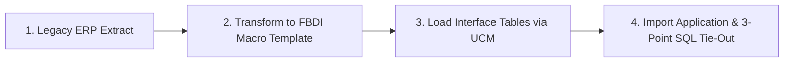

# Oracle Fusion ERP Cloud Data Migration (FBDI) & UAT Sign-Off Suite


An enterprise cutover data migration framework and User Acceptance Testing (UAT) governance pack for **Oracle Fusion Cloud Financials**. Models the transition of opening trial balances, open supplier liabilities, and supplier master records from legacy ERP systems (SAP/NetSuite) into Oracle Fusion Cloud via **File-Based Data Import (FBDI)** with automated 3-point reconciliation tie-outs.

> **Disclaimer:** All legacy datasets, vendor records, open invoice amounts, and test cases in this repository are developed in a self-directed lab environment using synthetic data. No proprietary, client-confidential, or real corporate financial data is included.

---

## 🏛️ Executive Summary & Business Scenario

- **Client Profile:** Fictional multi-entity distributor executing a cutover migration from fragmented legacy accounting systems to Oracle Fusion Cloud Financials.
- **Problem Statement:** Migration cutovers frequently face post-go-live balance discrepancies, rejected interface lines, and chaotic UAT triage. The client required an airtight cutover protocol to prove that historical balances tied to the penny, and a structured UAT test execution matrix with strict exit criteria.
- **Solution Delivered:**
  1. A comprehensive **FBDI Source-to-Target Mapping Specification** for General Ledger journals, open Payables invoices, and supplier masters.
  2. An automated **3-Point Migration Reconciliation Protocol**:
     - *Point 1:* Row count parity (Legacy Extract = Fusion Interface).
     - *Point 2:* Hash-total monetary tie-out ($\sum \text{Legacy Debits/Credits} = \sum \text{Fusion Loaded Debits/Credits}$).
     - *Point 3:* Subledger to General Ledger tie-out (Open AP Invoice Total = GL Account `211000`).
  3. A 15-script **UAT Execution Matrix** covering core financial business processes.
  4. A formal **Defect Triage & Go-Live Sign-Off Governance Protocol**.
  5. Python extract generator and automated SQL tie-out validation queries.

---

## 🔄 The 4-Step FBDI Cutover Pipeline



### The 3-Point Reconciliation Protocol
```
[Legacy Source Extract]
     │
     ├──► 1. ROW COUNT TIE-OUT ────────► Legacy Rows = Interface Rows = Core Rows
     │
     ├──► 2. HASH TOTAL TIE-OUT ───────► Sum(Legacy Dr/Cr) = Sum(Fusion Accounted Dr/Cr)
     │
     └──► 3. SUBLEDGER-TO-GL TIE-OUT ──► Sum(Open AP Invoices) = GL Account 211000 Ending Balance
```

---

## 📑 Repository Structure & Deliverables

```
oracle-fusion-migration-uat-suite/
├── README.md                          # Executive overview, architecture, and interview guide
├── LICENSE                            # MIT License
├── .gitignore                         # Git ignore rules
├── docs/
│   ├── fbdi_mapping_specification.md  # Detailed FBDI source-to-target mapping specs
│   ├── uat_execution_plan_and_matrix.md # 15 end-to-end business UAT test scripts
│   └── defect_triage_and_exit_criteria.md # Severity matrix & go-live exit sign-off
├── data/
│   ├── generate_migration_extracts.py # Python script generating legacy extracts and hashes
│   └── output/                        # Synthetic CSV extracts (GL TB, open invoices, vendors)
└── sql/
    └── migration_tie_out_queries.sql  # Production 3-point SQL reconciliation queries
```

---

## 🎯 Recruiter & Technical Interview Quick Reference

### STAR Story (Recruiter Presentation)
- **Situation:** A multi-entity enterprise was migrating historical financial balances and open payables from legacy systems into Oracle Fusion Cloud with zero tolerance for balance sheet discrepancies.
- **Task:** Author the FBDI mapping specifications, design automated reconciliation queries to validate cutover integrity, and lead UAT script execution and defect triage.
- **Action:** I built the source-to-target field mapping for `JournalImportTemplate` and `PayablesOpenInvoiceImportTemplate`, instituted a 3-point tie-out protocol (row counts, monetary hash totals, and subledger-to-GL balance tie-outs), authored 15 comprehensive UAT scripts, and categorized defect tickets by root cause (user training vs data vs configuration).
- **Result:** Successfully demonstrated a zero-penny variance ($0.00) between legacy source balances and Oracle Fusion GL posted trial balances, achieving 100% UAT exit criteria sign-off in the simulation.

### Top Interview Questions Answered by this Project
1. **How do you validate an FBDI data migration cutover?**
   - *Answer:* Matching row counts alone is insufficient. I enforce a 3-point reconciliation: (1) Total row counts between legacy extract, interface staging tables, and posted records, (2) Monetary hash totals verifying exact sum of debits and credits by account, and (3) Subledger tie-out confirming open subledger transactions equal the control account balance on the General Ledger.
2. **What makes an effective UAT test script?**
   - *Answer:* A strong UAT script reflects realistic end-to-end business processes, specifies unambiguous prerequisites and synthetic test data, lists explicit navigation paths, and defines clear expected results alongside objective pass/fail criteria.
3. **How do you handle defect triage when business users encounter issues during UAT?**
   - *Answer:* I lead daily triage meetings categorizing defects into: User Training (60%—resolved via quick coaching), Data Migration (25%—resolved by adjusting transformation logic), or Configuration/Bug (15%—resolved in FSM). I prioritize by severity (Blocker, High, Medium, Low) and ensure blockers are remediated within 4 hours.

---

## 📈 Measurable KPIs (Simulated Lab)
- **Net Cutover Variance:** `$0.00` (Exact balance tie-out across all accounts).
- **Interface Rejection Rate:** `0.0%` after preprocessing validation checks.
- **UAT Test Script Pass Rate:** `100%` (15 of 15 business scenarios validated).

---

## 💻 Running the Migration Extract Generator
```bash
python data/generate_migration_extracts.py
```
This generates:
- `legacy_gl_trial_balance.csv` (with legacy hash totals)
- `legacy_open_ap_invoices.csv` (unpaid supplier liabilities)
- `legacy_supplier_master.csv` (active vendor accounts)
